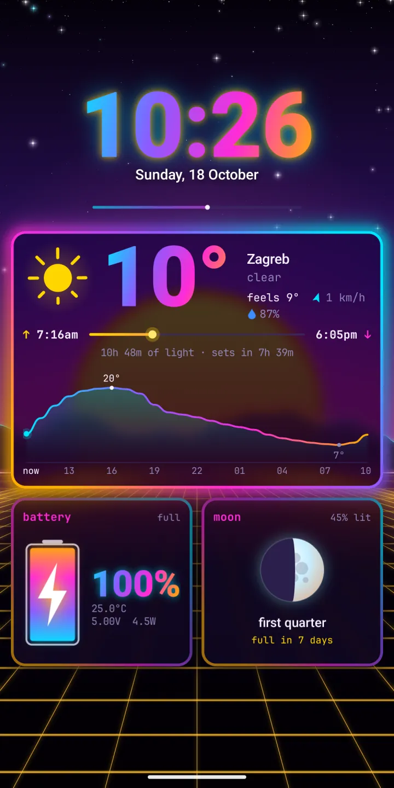

  

<h1 align="center">Hyprtile</h1>

A tiling Linux desktop as your Android home screen. Inspired by Hyprland, Omarchy and kitty.

  <a href="https://play.google.com/store/apps/details?id=com.zanoshky.hyprtile"><b>Google Play</b></a> ·
  <a href="https://hyprtile.zanoski.com"><b>hyprtile.zanoski.com</b></a> ·
  <a href="https://zanoshky.github.io/hyprtile-launcher/"><b>User guide</b></a> ·
  <a href="https://github.com/Zanoshky/hyprtile-launcher/issues/new/choose"><b>Report a bug</b></a>

  

This repo is the public home for Hyprtile users: the user guide, bug reports and feature requests. The app itself is a paid Android launcher and its source is not here.

## Quick start

1. Install Hyprtile from Google Play. It runs on Android 7 or newer.
2. Open it and take the tour. It acts out each gesture on your own windows.
3. Tap set up your phone: default home, lock screen, notification access and more.
4. Swipe sideways for workspaces, swipe up for rofi, double tap a window for full screen.
5. Hold an empty spot for edit mode, then pick a preset under look.

## The guide

| Page | What is in it |
| --- | --- |
| [Guide](https://zanoshky.github.io/hyprtile-launcher/guide.html) | Everything from A to Z, in order |
| [Use cases](https://zanoshky.github.io/hyprtile-launcher/use-cases.html) | Ways to set it up |
| [Cookbook](https://zanoshky.github.io/hyprtile-launcher/cookbook.html) | Short recipes, a few taps each |
| [FAQ](https://zanoshky.github.io/hyprtile-launcher/faq.html) | Answers and fixes for common problems |
| [Report a bug](https://zanoshky.github.io/hyprtile-launcher/report.html) | What to include in a good report |

The guide source is plain HTML in [docs](docs).

## Report a bug or ask for a feature

1. Search the [open issues](https://github.com/Zanoshky/hyprtile-launcher/issues) first. If yours is there, add a thumbs up or a comment.
2. Otherwise open a [bug report](https://github.com/Zanoshky/hyprtile-launcher/issues/new?template=bug_report.yml) or a [feature request](https://github.com/Zanoshky/hyprtile-launcher/issues/new?template=feature_request.yml).
3. Add your app version, phone model and Android version, and a screenshot if you can. Crop out anything private first: issues are public.

## License

The guide text and images in this repo are shared under [CC BY 4.0](LICENSE). The Hyprtile app itself is proprietary and is not covered by this license.
